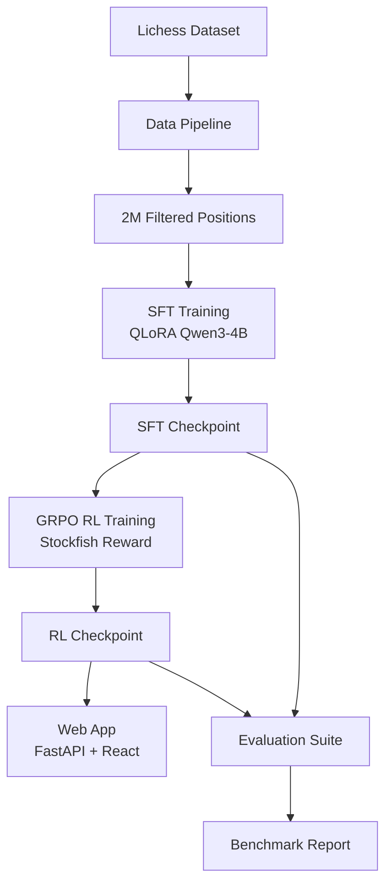
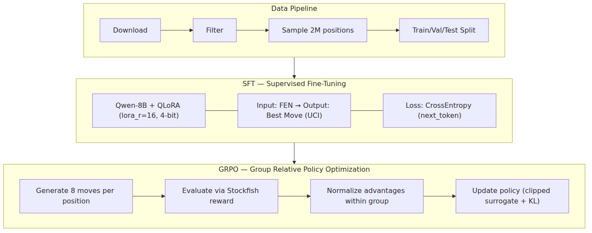
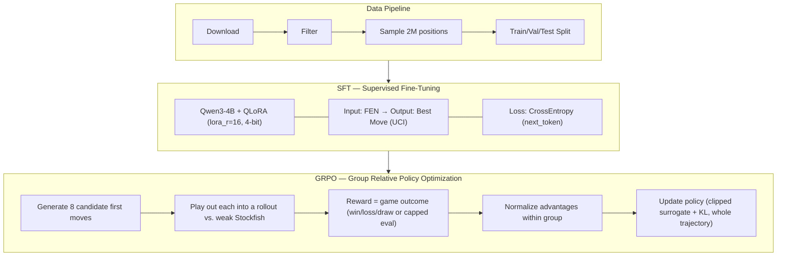

# ♟ Qwen Chess RL

**Train Qwen (default: Qwen3-4B) to play chess via Supervised Fine-Tuning (SFT) and Reinforcement Learning (GRPO)**

This project implements an end-to-end training pipeline for fine-tuning a **Qwen** model (default **`Qwen/Qwen3-4B`**) to play chess, using ~2 million labelled chess positions from Lichess. It includes:

- 📥 **Data Pipeline** — Download, filter, and sample 2M chess positions from the [Lichess chess position evaluations](https://huggingface.co/datasets/Lichess/chess-position-evaluations) dataset
- 🎯 **SFT Training** — Supervised fine-tuning with QLoRA to predict best moves from FEN positions
- 🧠 **GRPO RL** — Group Relative Policy Optimization with Stockfish as the reward function
- 🔬 **LUFFY Off-Policy Guidance** — Inject Stockfish expert traces into GRPO via importance-sampling corrections, preventing learning stalls without collapsing into imitation
- 📊 **Evaluation Suite** — Benchmark against Stockfish, random players, and puzzle datasets
- 🌐 **Web Application** — Interactive chess UI similar to the [Qwen Chess demo](https://qwen-chess.replit.app/)

---

## 📋 Table of Contents

- [Architecture](#architecture)
- [Quick Start](#quick-start)
- [Dataset Preparation](#dataset-preparation)
- [Training](#training)
- [Evaluation](#evaluation)
- [Web Application](#web-application)
- [Docker Deployment](#docker-deployment)
- [Project Structure](#project-structure)
- [Development](#development)
- [Configuration](#configuration)
- [Results](#results)
- [References](#references)
- [Citation](#citation)

---

## 🏗 Architecture



### Training Pipeline



<details>
<summary>View as Mermaid source</summary>



</details> (docs: replace ASCII training pipeline with Mermaid PNG)

### Reward Function

GRPO's primary reward signal is **the actual outcome of the game**, not just
the quality of one isolated move — a candidate move is played out into a
full multi-ply rollout against a deliberately weakened Stockfish opponent
(see [rollout.py](qwen_chess_rl/training/rl/rollout.py)), and the reward is
tied to whether that rollout was won, lost, or drawn:

Only a decisive outcome carries any reward — a "normal" undecided move earns
nothing, and neither does mere legality (`LEGAL_MOVE_BONUS = 0`):

| Outcome | Reward | Description |
|---------|--------|-------------|
| Win | `+20` | The policy's side won the rollout |
| Loss | `-20` | The policy's side lost, or played an illegal move mid-game |
| Draw (from a balanced/winning start) | `0` | Neutral — failed to convert an advantage, but not punished |
| Draw (salvaged from a clearly losing start) | `+10` | Winning wasn't realistic there, so holding a draw is a good outcome, not a failure |
| Capped (no natural end reached) | `0` | Just a normal, undecided move — no reward either way |

A configurable fraction of rollouts (`rollout_full_game_ratio`, default
`0.5`) play to a natural conclusion (checkmate/draw); the rest are capped
at `rollout_max_plies` (default `10`) plies for cost and score `0`, since
they never reached a decisive result. The opponent uses a shallow search
(`opponent_depth`, default `3`) — a full-strength opponent would rarely
lose to a still-learning policy, starving training of win signal.

Note: since capped rollouts always score `0` regardless of position, they
contribute no learning signal by themselves — only full-game rollouts (and
any capped candidate that happens to end early via checkmate) drive
training. If you're not seeing enough win/loss signal, consider raising
`rollout_full_game_ratio` toward `1.0`.

Whether a draw counts as "salvaged" is decided by Stockfish's eval of the
*starting* position (before any move) — below `LOSING_EVAL_THRESHOLD`
(`-150` centipawns) counts as clearly lost. Win/loss rewards are unaffected;
only a draw's value depends on the starting position.

A single move's intrinsic quality (legality, centipawn loss vs. Stockfish's
top choice, blunders, immediate checkmate/repetition) is still scored by
[`compute_reward`](qwen_chess_rl/training/rl/reward.py) and used elsewhere
(e.g. LUFFY's off-policy traces) — see that function's docstring for its
component breakdown.

---

## 🚀 Quick Start

### Prerequisites

- Python 3.10–3.12
- [uv](https://docs.astral.sh/uv/) for dependency management
- CUDA-compatible GPU (recommended: 16GB+ VRAM for Qwen3-4B QLoRA)
- Stockfish chess engine (`sudo apt-get install stockfish`)
- For optional FlashAttention: NVIDIA CUDA Toolkit with `nvcc` (not just the driver)

### Installation

```bash
# Clone the repository
git clone https://github.com/deep-science-ai/qwen-chess-rl.git
cd qwen-chess-rl

# Create virtual environment
uv venv
source .venv/bin/activate

# Install dependencies (training works without flash-attn; uses SDPA)
uv pip install -e ".[dev,train]"

# Optional: Install PyTorch with CUDA support (match your CUDA major version)
uv pip install torch torchvision torchaudio --index-url https://download.pytorch.org/whl/cu13.2
```

#### Optional: FlashAttention

`flash-attn` must be compiled against your installed CUDA toolkit. It is **not** part of `[train]` because builds fail without `nvcc` / `CUDA_HOME`.

```bash
# 1. Install CUDA toolkit (example: NVIDIA local installer / cuda-toolkit package)
#    Confirm: nvcc --version
# 2. Point builds at the toolkit
export CUDA_HOME=/usr/local/cuda   # or your toolkit root
export PATH="$CUDA_HOME/bin:$PATH"

# 3. Build against the venv's torch (required)
uv pip install flash-attn --no-build-isolation
# or: uv pip install -e ".[flash]" --no-build-isolation
```

If `uv add flash-attn` fails with `No module named 'torch'`, use `--no-build-isolation` (or keep `[tool.uv.extra-build-dependencies]` for `flash-attn = ["torch"]`).

### Verify Setup

```bash
# Check Stockfish is available
stockfish --version

# Check CUDA
uv run python -c "import torch; print(f'CUDA: {torch.cuda.is_available()}')"
```

---

## 📥 Dataset Preparation

### Download and Process

```bash
# Run the full pipeline: download → filter → sample 2M → split
uv run python -m qwen_chess_rl.data.download
```

This will:
1. Stream the Lichess chess position evaluations dataset (full dataset is ~40GB; streaming only downloads as many shards as needed to fill the sample, typically a few GB)
2. Filter positions by quality (max centipawn loss < 200, valid FEN)
3. Sample ~2 million positions
4. Split into train (98%), validation (1%), test (1%)
5. Save to `data/processed/{train,val,test}` in Arrow format

### Custom Options

```python
from qwen_chess_rl.data.download import run_pipeline

paths = run_pipeline(
    cache_dir="data/raw",
    output_dir="data/processed",
    target_size=2_000_000,
    num_proc=8,
    seed=42,
    streaming=True,      # set False to download the full ~40GB dataset up front
    validate_fen=False,  # set True to also validate FEN strings via python-chess (slow, ~0 rows rejected)
)
```

| Parameter | Default | Description |
|-----------|---------|-------------|
| `cache_dir` | `data/raw` | Where downloaded shards (or the full dataset) are cached |
| `output_dir` | `data/processed` | Where the final train/val/test splits are saved |
| `target_size` | `2_000_000` | Number of positions to sample |
| `num_proc` | `8` | Parallel processes for filtering |
| `seed` | `42` | Random seed for shard order, shuffling, and splitting |
| `streaming` | `True` | Download Parquet shards one at a time until enough positions are collected, instead of the full ~40GB dataset |
| `validate_fen` | `False` | Validate FEN strings via python-chess. Costly (full board parsing per row) and rejects ~0 rows on this dataset, so it's off by default |

---

## 🎯 Training

### Stage 1: Supervised Fine-Tuning (SFT)

Fine-tune Qwen using QLoRA to predict the best move from FEN positions.

The full ~2M train set is **not required** for a useful LoRA run. By default the
script uses a shuffled subset of **50k train / 2k val** examples. Pass
`--max-train-samples -1` for the full dataset.

> **Training target:** Lichess rows store the Stockfish PV in `line` (e.g.
> `e2e4 e7e5 ...`). SFT uses the **first UCI move** from that field as the label.
> If you trained before this fix, checkpoints only learned to emit end-of-turn —
> retrain SFT after pulling the latest code.

```bash
# Default training (50k train / 2k val)
bash scripts/train_sft.sh

# Faster smoke test
bash scripts/train_sft.sh --max-train-samples 5000 --max-eval-samples 500

# Full dataset
bash scripts/train_sft.sh --max-train-samples -1 --max-eval-samples -1

# With custom options
bash scripts/train_sft.sh \
    --model Qwen/Qwen3.5-0.8B \
    --data data/processed \
    --output checkpoints/sft \
    --batch-size 192 \
    --lr 2e-4 \
    --max-steps 10000 \
    --max-train-samples 50000
```

Example: 
```bash
bash scripts/train_sft.sh \
    --model qwen/qwen3.5-9B \
    --batch-size 1024 \
    --max-steps 10000 \
    --data data/processed \
    --max-train-samples 50000 
```

**Options** (`bash scripts/train_sft.sh [options]`):

| Flag | Default | Description |
|------|---------|-------------|
| `--config PATH` | — | YAML config file (see [YAML Config](#yaml-config-advanced)) |
| `--model NAME` | `Qwen/Qwen3-4B` | HuggingFace model identifier |
| `--data PATH` | `data/processed` | Path to processed dataset |
| `--output DIR` | `checkpoints/sft` | Checkpoint output directory |
| `--batch-size N` | `4` | Per-device training batch size |
| `--lr RATE` | `2e-4` | Peak learning rate |
| `--max-steps N` | `-1` | Max training steps (`-1` = use epochs) |
| `--max-train-samples N` | `50000` | Cap on training examples (`-1` = full set) |
| `--max-eval-samples N` | `2000` | Cap on validation examples (`-1` = full set) |
| `--no-wandb` | off | Disable Weights & Biases logging |

**Configuration** (see `qwen_chess_rl/training/sft/config.py`):

| Parameter | Value | Description |
|-----------|-------|-------------|
| `lora_r` | 16 | LoRA rank dimension |
| `lora_alpha` | 32 | LoRA scaling parameter |
| `use_4bit` | True | 4-bit quantization (QLoRA) |
| `batch_size` | 4 | Per-device batch size |
| `gradient_accumulation_steps` | 8 | Effective batch size: 32 |
| `learning_rate` | 2e-4 | Peak learning rate |
| `optim` | `paged_adamw_8bit` | Memory-efficient optimizer |
| `max_length` | 512 | Max sequence length |
| `max_train_samples` | 50000 | Default training subset size |
| `max_eval_samples` | 2000 | Default validation subset size |

**Memory requirements:** ~24GB GPU RAM (QLoRA 4-bit, batch_size=4 on RTX 5090)

### Stage 2: GRPO Reinforcement Learning

Improve the SFT model using GRPO with Stockfish as the reward function.

```bash
# Default training
bash scripts/train_grpo.sh

# With custom options
bash scripts/train_grpo.sh \
    --sft-checkpoint checkpoints/sft/final \
    --output checkpoints/rl \
    --steps 1000 \
    --lr 5e-6
```

**Options** (`bash scripts/train_grpo.sh [options]`):

| Flag | Default | Description |
|------|---------|-------------|
| `--config PATH` | — | YAML config file (see [YAML Config](#yaml-config-advanced)) |
| `--sft-checkpoint PATH` | `checkpoints/sft/final` | SFT checkpoint to start RL from |
| `--data PATH` | `data/processed` | Processed dataset for GRPO rollout prompts — independent of SFT's `--data`, can point at a different dataset |
| `--output DIR` | `checkpoints/rl` | RL checkpoint output directory |
| `--steps N` | `1000` | Number of GRPO training steps |
| `--lr RATE` | `5e-6` | Peak learning rate |
| `--luffy-alpha RATIO` | `0.85` | Ratio of off-policy (LUFFY) to on-policy (GRPO) loss: `(1 - luffy_alpha) * onpolicy + luffy_alpha * offpolicy`. `0` = pure GRPO, `1` = pure LUFFY imitation |
| `--max-train-samples N` | `500000` | Cap on FEN prompts sampled for rollouts (`-1` = full dataset) |

Requires `STOCKFISH_PATH` (default `stockfish`) to point to a working Stockfish binary — the script warns if it can't find one.

**Configuration** (see `qwen_chess_rl/training/rl/config.py`):

| Parameter | Value | Description |
|-----------|-------|-------------|
| `num_generations` | 8 | Moves sampled per position |
| `clip_epsilon` | 0.2 | PPO clipping parameter |
| `beta` | 0.01 | KL penalty coefficient |
| `batch_size` | 8 | Prompts per training batch |
| `ppo_epochs` | 4 | Inner PPO update iterations |
| `temperature` | 1.0 | Move sampling temperature |
| `rollout_full_game_ratio` | 0.5 | Fraction of candidates per step played to a natural conclusion vs. capped |
| `rollout_max_plies` | 10 | Ply cap for the capped share of rollouts |
| `opponent_depth` | 3 | Stockfish search depth for the rollout opponent (deliberately shallow) |

---

## 📊 Evaluation

### Run Full Benchmark

```bash
# Evaluate a checkpoint
bash scripts/evaluate.sh checkpoints/sft/final

# Compare multiple checkpoints
bash scripts/evaluate.sh checkpoints/sft/final \
    --compare checkpoints/rl/checkpoint-500 checkpoints/rl/final
```

**Options** (`bash scripts/evaluate.sh <checkpoint_path> [options]`):

| Flag | Default | Description |
|------|---------|-------------|
| `--output-dir DIR` | `evaluation_results` | Results directory |
| `--stockfish-games N` | `20` | Games played vs Stockfish |
| `--random-games N` | `10` | Games played vs a random-move baseline |
| `--stockfish-depth N` | `8` | Stockfish search depth |
| `--stockfish-skill-level N` | full strength | Stockfish "Skill Level" (0-20, 0 = weakest) |
| `--temperature T` | `0.1` | Move sampling temperature |
| `--engine {llm,search,hybrid}` | `llm` | Policy: raw LLM, classical alpha-beta search alone, or LLM vetted by search (see below) |
| `--search-depth N` | `4` | Alpha-beta depth for `search`/`hybrid` |
| `--search-time-limit T` | `1.0` | Per-move time budget (seconds) for `search`/`hybrid` |
| `--hybrid-margin CP` | `50` | Centipawn margin for `hybrid` (see below) |
| `--compare CKPT ...` | — | Additional checkpoints to compare against |

### Classical Search Engine

The fine-tuned LLM does one-shot next-token generation for a move — it has
**no look-ahead** and cannot reliably avoid one-move tactical blunders
against any real chess engine. [`qwen_chess_rl/engine/classical.py`](qwen_chess_rl/engine/classical.py)
adds a self-contained alpha-beta search (material + piece-square tables +
mobility + king safety, quiescence search on captures, iterative deepening,
a transposition table) that gives the system genuine tactical calculation.
It's exposed as three selectable `--engine` modes:

- `llm` — the raw fine-tuned model, unchanged.
- `search` — the classical engine alone, no model needed at all.
- `hybrid` — asks the LLM for its move, then plays it only if the search
  agrees it's within `--hybrid-margin` centipawns of the search's own best
  move; otherwise (or if the LLM's move is illegal/unparseable) falls back
  to the search's move as a tactical safety net.

`--stockfish-skill-level` configures Stockfish's own "Skill Level" UCI
option (0-20, 0 = weakest) — a standard, legitimate way to play a
deliberately weaker Stockfish, distinct from just capping search depth.

### Metrics Reported

| Metric | Description |
|--------|-------------|
| **Avg Centipawn Loss** | Average score difference vs Stockfish's best move |
| **Legal Move %** | Fraction of generated moves that are legal |
| **Win Rate vs Stockfish** | Win/loss/draw rate at depth 8 |
| **Win Rate vs Random** | Baseline performance |
| **Estimated Elo** | Rating estimated from Stockfish match results |
| **Puzzle Accuracy** | % correct on chess puzzle datasets |

### Programmatic Evaluation

```python
from qwen_chess_rl.evaluation.benchmark import run_full_benchmark

results = run_full_benchmark(
    checkpoint_path="checkpoints/sft/final",
    stockfish_games=20,
    stockfish_depth=8,
)
print(results["vs_stockfish"]["estimated_elo"])
```

---

## 🌐 Web Application

Play against your trained model in the browser. This project’s training scripts
default to **`Qwen/Qwen3-4B`**. Your LoRA adapters under
`checkpoints/sft/final` or `checkpoints/rl/final` are fine-tunes of that base model.

### How to play (local)

**Terminal 1 — backend** (loads the checkpoint; first start downloads the base model if needed):

```bash
cd ~/workspace/qwen-chess-rl
source .venv/bin/activate

# SFT model, or use checkpoints/rl/final after GRPO
export QWEN_CHESS_CHECKPOINT=checkpoints/sft/final
uv run uvicorn qwen_chess_rl.web.backend.main:app --host 0.0.0.0 --port 8000
```

You can also set `QWEN_CHESS_CHECKPOINT` in `.env` instead of exporting it.

Check that the real model id is reported:

```bash
curl -s http://localhost:8000/health
# expect: "model_loaded": true, "model_name": "Qwen/Qwen3-4B"
```

**Terminal 2 — frontend**:

```bash
cd ~/workspace/qwen-chess-rl/web/frontend
npm install
npm run dev
```

Open **http://localhost:3000**, click **New Game**, and drag pieces as White.
The model replies after each of your moves. The page subtitle shows the loaded
base model name (e.g. `Qwen/Qwen3-4B`).

### API Endpoints

| Endpoint | Method | Description |
|----------|--------|-------------|
| `/health` | GET | Server health check |
| `/new_game` | POST | Start new game session |
| `/move` | POST | Make a move + get AI response |
| `/game/{session_id}` | GET | Get current game state |
| `/undo/{session_id}` | POST | Undo last move pair |
| `/import_fen` | POST | Import FEN position |
| `/fen_export/{session_id}` | GET | Export FEN + PGN |

### Features

- Interactive chessboard (drag-and-drop)
- Play as white or black
- FEN import/export for analysis
- PGN move history display
- Adjustable model temperature
- Responsive UI (desktop + mobile)
- Move explanations (AI thinking indicator)

---

## 🐳 Docker Deployment

### Full Stack

```bash
# Start the web application
docker compose up web

# Start training
docker compose --profile train up train-sft
docker compose --profile train up train-grpo

# Run evaluation
docker compose --profile eval up evaluate
```

### Build Custom Images

```bash
# Web application
docker build --target full -t qwen-chess-web .

# Training
docker build --target training -t qwen-chess-train .
```

---

## 📁 Project Structure

```
qwen-chess-rl/
├── qwen_chess_rl/              # Main package
│   ├── data/                   # Data pipeline
│   │   ├── download.py         # Download + filter + sample
│   │   ├── preprocess.py       # FEN tokenization
│   │   └── dataset.py          # PyTorch Dataset
│   ├── training/
│   │   ├── sft/                # Supervised Fine-Tuning
│   │   │   ├── config.py       # QLoRA hyperparameters
│   │   │   └── train.py        # SFT training loop
│   │   └── rl/                 # Reinforcement Learning
│   │       ├── config.py       # GRPO + LUFFY hyperparameters
│   │       ├── reward.py       # Stockfish reward function
│   │       ├── grpo.py         # GRPO training loop (LUFFY-aware)
│   │       └── luffy/          # LUFFY off-policy guidance
│   │           ├── schema.py        # Trace data schema
│   │           ├── trace_generator.py # Stockfish trace generation
│   │           ├── buffer.py        # Mixed experience buffer
│   │           ├── is_weights.py    # IS weights & regularisation
│   │           ├── training.py      # LUFFY training integration
│   │           └── ablation.py      # Experiment runner
│   ├── evaluation/
│   │   ├── metrics.py          # Centipawn loss, legal %, Elo
│   │   ├── stockfish_eval.py   # Play games vs Stockfish
│   │   └── benchmark.py        # Full benchmark orchestrator
│   └── web/
│       ├── backend/
│       │   └── main.py         # FastAPI server
│       └── frontend/
│           ├── src/            # React components
│           └── package.json
├── scripts/                    # Shell scripts
│   ├── train_sft.sh
│   ├── train_grpo.sh
│   └── evaluate.sh
├── docs/                       # Documentation
├── tests/                      # Unit tests
├── Dockerfile
├── docker-compose.yml
└── README.md
```

---

## 🛠 Development

Install dev tools with `pip install -e ".[dev]"` (or `uv sync --extra dev`).

### Linting (ruff)

```bash
ruff check .          # lint
ruff check --fix .    # lint and auto-fix what's safe to fix
ruff format .         # format code
```

Rules are configured in `[tool.ruff]` in `pyproject.toml` (target Python 3.10, 100-char lines, `E`/`F`/`I`/`N`/`W`/`UP` rule sets).

### Tests (pytest)

```bash
pytest                    # run the test suite
pytest --cov=qwen_chess_rl # with coverage
```

---

## ⚙️ Configuration

### Environment Variables

```bash
# Copy the template and fill in your own values
cp .env.example .env
```

`.env` is loaded automatically (via `python-dotenv`) whenever `qwen_chess_rl` is imported, and is gitignored so real tokens never get committed.

| Variable | Default | Description |
|----------|---------|-------------|
| `HF_TOKEN` | — | HuggingFace Hub token — raises API rate limits and speeds up dataset downloads |
| `CUDA_VISIBLE_DEVICES` | `0` | GPU device IDs |
| `QWEN_CHESS_CHECKPOINT` | — | Model checkpoint path for web app |
| `STOCKFISH_PATH` | `stockfish` | Stockfish binary location |
| `WANDB_API_KEY` | — | Weights & Biases logging key |
| `OMP_NUM_THREADS` | `8` | OpenMP threads for data loading |

### YAML Config (Advanced)

Create a `config.yaml`:
```yaml
model_name: Qwen/Qwen3-4B
lora_r: 32
lora_alpha: 64
batch_size: 8
learning_rate: 3e-4
```

Then:
```bash
bash scripts/train_sft.sh --config config.yaml
```

---

## 📈 Results

Benchmark from [`evaluation_results/comparison.json`](evaluation_results/comparison.json)
(default protocol: **20 games vs Stockfish depth 8**, **10 games vs random**,
temperature `0.1`, base model `Qwen/Qwen3-1.7B` — previous default, not 4B).

```bash
bash scripts/evaluate.sh checkpoints/sft/final --compare checkpoints/rl/final
```

### Head-to-head: SFT vs GRPO

| Metric | SFT (`checkpoints/sft/final`) | GRPO (`checkpoints/rl/final`) |
|--------|-------------------------------|-------------------------------|
| vs Stockfish (d8) W–D–L | 0–0–20 | 0–0–20 |
| Win rate vs Stockfish | 0% | 0% |
| Loss rate vs Stockfish | 100% | 100% |
| Avg game length (plies) | 44.7 | 47.5 |
| Estimated Elo (from match) | 1600 | 1600 |
| vs Random W–D–L | 0–9–1 | 0–6–4 |
| Draw rate vs random | 90% | 60% |
| Win rate vs random | 0% | 0% |

Neither checkpoint scored a win against Stockfish at depth 8. GRPO games lasted slightly
longer on average (47.5 vs 44.7 plies). Against a random-move opponent, SFT drew more
often (9/10 vs 6/10); neither model won a game.

This isn't a training-data or reward-shaping gap: `choose_uci_move` (see
[`inference.py`](qwen_chess_rl/inference.py)) does one-shot next-token
generation with **no look-ahead**, so it can't reliably avoid one-move
tactical blunders against any engine doing real search — regardless of how
long GRPO trains.

### Classical search engine: >50% vs Stockfish

Real, reproducible results from `--engine search` (the classical alpha-beta
engine, [`qwen_chess_rl/engine/classical.py`](qwen_chess_rl/engine/classical.py),
depth 4, 1.0s/move — no LLM involved) against Stockfish configured to
**Skill Level 0** (its own weakest official strength setting) at depth 5:

```bash
# checkpoint arg is ignored/unused by --engine search — pass any placeholder
bash scripts/evaluate.sh none --engine search \
    --stockfish-games 20 --stockfish-depth 5 --stockfish-skill-level 0 \
    --search-depth 4 --search-time-limit 1.0 --output-dir evaluation_results_search
```

| Run | W–D–L | Win rate |
|-----|-------|----------|
| Official harness, 20 games | 20–0–0 | 100% |
| Official harness, 6 games | 6–0–0 | 100% |
| Ad-hoc script, 20 games | 19–0–1 | 95% |
| Ad-hoc script, 10 games | 6–3–1 | 60% |
| **Combined (56 games)** | **51–3–2** | **91%** |

Raw artifact: [`evaluation_results_search/benchmark_results.json`](evaluation_results_search/benchmark_results.json).
Note: the harness's `estimated_elo` assumes a fixed 2000-Elo opponent baseline
calibrated for depth-8 Stockfish — it does **not** reflect Skill Level 0's
real (much lower) strength, so ignore that field for this configuration; the
win/draw/loss counts are what's meaningful here.

`--engine hybrid` (LLM move, vetted by the same search) is also available
once a checkpoint exists, to keep the fine-tuned model's style while using
search as a blunder-check — see [Classical Search Engine](#classical-search-engine) above.

### Test-set label checks

These metrics score **dataset labels** (first Stockfish PV move on 1000 test FENs),
not model generations — so SFT and GRPO share the same numbers:

| Metric | Value |
|--------|-------|
| Legal move % (labels) | 100% |
| Avg centipawn loss (labels) | 259.5 |
| Median centipawn loss (labels) | 0.0 |
| Samples | 1000 |

Raw artifacts: [`evaluation_results/comparison.json`](evaluation_results/comparison.json),
[`evaluation_results/benchmark_results.json`](evaluation_results/benchmark_results.json).

---
## 📚 Documentation

Detailed documentation is available in the `docs/` directory:

- [Dataset Preparation](docs/dataset.md)
- [Training Guide](docs/training.md)
- [Evaluation](docs/evaluation.md)
- [Deployment Guide](docs/deployment.md)
- [Architecture Overview](docs/architecture.md)
- [GRPO + On-Policy Distillation explainer notebook](notebooks/grpo_and_onpolicy_distillation.ipynb) ([how to run](notebooks/README.md))

---

## 📚 References

Papers describing the core techniques this project implements:

- Hu et al., 2021 — [LoRA: Low-Rank Adaptation of Large Language Models](https://arxiv.org/abs/2106.09685)
- Dettmers et al., 2023 — [QLoRA: Efficient Finetuning of Quantized LLMs](https://arxiv.org/abs/2305.14314)
- Shao et al., 2024 — [DeepSeekMath: Pushing the Limits of Mathematical Reasoning in Open Language Models](https://arxiv.org/abs/2402.03300) (introduces GRPO)
- Schulman et al., 2017 — [Proximal Policy Optimization Algorithms](https://arxiv.org/abs/1707.06347) (the clipped-surrogate objective GRPO builds on)
- Qwen Team, Alibaba — [Qwen2 Technical Report](https://arxiv.org/abs/2407.10671)
- Silver et al., 2017 — [Mastering Chess and Shogi by Self-Play with a General Reinforcement Learning Algorithm](https://arxiv.org/abs/1712.01815) (AlphaZero; broader context for RL-trained chess play)

---

## 📖 Citation

```bibtex
@software{qwen_chess_rl,
  title = {Qwen Chess RL: Fine-tuning Qwen3-4B for Chess via SFT and GRPO},
  author = {El Fayoumi, Ibrahim},
  year = {2026},
  url = {https://github.com/deep-science-ai/qwen-chess-rl}
}
```

---

## 📝 License

Proprietary — Copyright ©2026 DSAI. All Rights Reserved.

---

*Built with [Qwen3-4B](https://huggingface.co/Qwen/Qwen3-4B), [HuggingFace Transformers](https://github.com/huggingface/transformers), [TRL](https://github.com/huggingface/trl), and [python-chess](https://python-chess.readthedocs.io/).*
